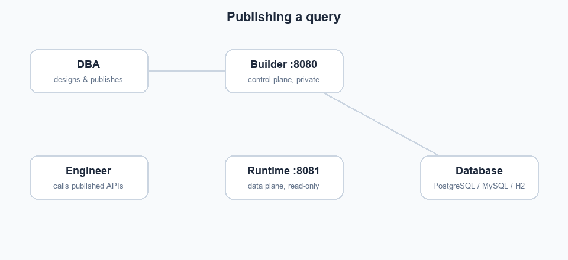
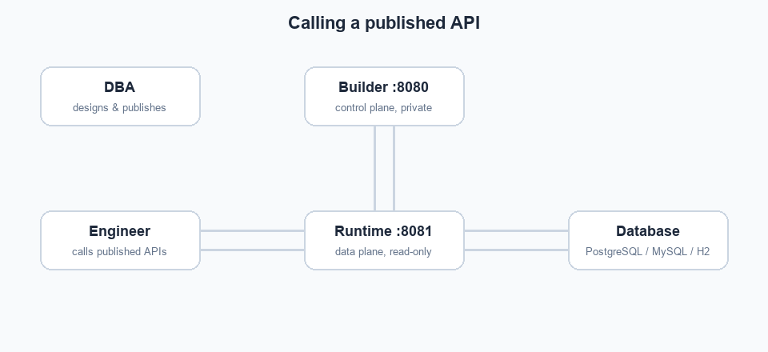

# API Builder &mdash; a curated query gateway

Give engineers the data they need **without handing out database access**.

Instead of a DBA either sharing database credentials (now everyone can run anything) or acting as a human query queue, the DBA deploys this service in front of the database. The DBA holds the only connection, builds vetted queries in a low-code web page, and publishes each one as a safe, read-only REST endpoint. Engineers call the endpoints &mdash; they never touch the database and never send SQL.

In short: **your DBA curates a menu of approved queries instead of handing out the keys to the kitchen.**

It ships as Docker images and sits next to an existing PostgreSQL, MySQL/MariaDB or H2 database.

## How it works

The DBA publishes a query once. Engineers then call the endpoint and never see the database.

| Publishing (DBA) | Calling (engineer) |
|---|---|
|  |  |

## Two planes


| Service | Port | Plane | Who | Notes |
|---|---|---|---|---|
| **builder** | 8080 | Control | DBA only | Serves the web UI, validates/versions/stores APIs, owns the time machine, diff & cURL builder. **Admin login required.** Deploy it privately. |
| **runtime** | 8081 | Data | Engineers | Serves every published `/api/**`. Resolves each definition from the builder, compiles it to SQL, runs it **read-only**. No login by default. |
| **shared** | &mdash; | &mdash; | &mdash; | A library (not a service): the query model, SQL compiler, schema introspection and row runner, reused by both services. |

Why two deployables instead of one: the split is a **security boundary**. Engineers can only reach the data plane, on a network that has no access to the publish endpoints or the metadata &mdash; it's enforced by deployment, not just by an in-app check. The DBA's control plane stays private.

What makes it safe:

- Engineers never get database credentials &mdash; the single connection lives inside the containers.
- The runtime connects **read-only**; a published query cannot modify data.
- Callers send only the parameter *values* the DBA exposed, never SQL. Every value is bound as a statement parameter, so injection is impossible by construction.
- Table and column names are validated against the live schema, so a query can't reach beyond what the DBA built. The builder's own metadata lives in a separate database a published API can never touch.

Built with Spring Boot 4, Spring Security, Spring JDBC and Spring MVC `RestClient`.

## Quick start with Docker

Requirements: Docker with Compose.

```powershell
Copy-Item .env.example .env      # cp .env.example .env on macOS or Linux
# edit .env and set ADMIN_PASSWORD
docker compose up --build -d
```

As shipped, `.env` also starts a demo PostgreSQL database with two sample tables (`accounts`, `transactions`) so you can try it immediately.

1. Open the builder (control plane) at <http://localhost:8080/> and sign in with `ADMIN_USERNAME` / `ADMIN_PASSWORD`.
2. On the **Build** tab, name an API `rich-accounts`, keep some columns, and add a filter `balance > ` caller parameter `minimum`.
3. Click **Preview**, then **Publish API**.
4. An engineer now calls it on the data plane &mdash; no login:
   `curl "http://localhost:8081/api/rich-accounts?minimum=1000"`

Stop it with `docker compose down`. Add `-v` to also delete the published APIs and the demo data.

### Using it with your own database

Edit `.env`:

1. Set a strong `ADMIN_PASSWORD`.
2. Remove the `COMPOSE_PROFILES=demo` line so the demo database is not started.
3. Set `TARGET_DB_URL`, `TARGET_DB_USER` and `TARGET_DB_PASSWORD`. Use a **read-only** account; the builder never writes to your database.
4. Optionally set `TARGET_DB_SCHEMA` to the schema (PostgreSQL) or database (MySQL) to expose.
5. To let engineers reach the data plane from other machines, set `RUNTIME_BIND=0.0.0.0`. Keep `BUILDER_BIND=127.0.0.1` so the control plane stays private (the DBA reaches it on the host or over an SSH tunnel).

| Variable | Default | Purpose |
|---|---|---|
| `ADMIN_USERNAME` / `ADMIN_PASSWORD` | `admin` / (required) | The builder login |
| `TARGET_DB_URL` | required | `jdbc:postgresql://host:5432/db` or `jdbc:mysql://host:3306/db` |
| `TARGET_DB_USER` / `TARGET_DB_PASSWORD` | required / empty | Database account, preferably read-only |
| `TARGET_DB_SCHEMA` | connection default | Schema (PostgreSQL) or database (MySQL) whose tables are exposed |
| `BUILDER_PORT` / `BUILDER_BIND` | `8080` / `127.0.0.1` | Control plane host port and interface &mdash; keep private |
| `RUNTIME_PORT` / `RUNTIME_BIND` | `8081` / `127.0.0.1` | Data plane host port and interface &mdash; `0.0.0.0` to share |
| `RUNTIME_PUBLIC_URL` | `http://localhost:8081` | Base URL used in generated curl commands |
| `INTERNAL_TOKEN` | empty | Optional shared secret for the runtime&rarr;builder resolve call |

Reaching a database elsewhere:

- **On the host machine:** use `host.docker.internal` as the host in `TARGET_DB_URL`.
- **In another compose project:** attach the `builder` and `runtime` services to that project's network with a `docker-compose.override.yml`:

  ```yaml
  services:
    builder:
      networks: [default, app]
    runtime:
      networks: [default, app]
  networks:
    app:
      name: myapp_default
      external: true
  ```

## Deploying to Kubernetes (Helm)

The chart in [deploy/helm/api-builder](deploy/helm/api-builder) installs both services into whatever namespace you choose. Nothing is hard-coded to a namespace or release name.

1. Build and push the two images from the same Dockerfile (`MODULE=builder-service` and `MODULE=runtime-service`) to a registry your cluster can pull from.
2. Install into a namespace:

   ```bash
   helm install orders-apis deploy/helm/api-builder -n team-orders --create-namespace \
     --set images.builder.repository=registry.example.com/api-builder-builder \
     --set images.runtime.repository=registry.example.com/api-builder-runtime \
     --set images.builder.tag=1.0.0 --set images.runtime.tag=1.0.0 \
     --set targetDatabase.url=jdbc:postgresql://db.example.internal:5432/app \
     --set targetDatabase.username=api_reader \
     --set builder.adminPassword='choose-a-strong-password' \
     --set runtime.publicUrl=https://apis.example.com
   ```

   Keep secrets out of shell history by using `secrets.existingSecret` with a Secret you create (keys `adminPassword`, `targetDbPassword`, `internalToken`).
3. The builder is a `ClusterIP` service only (DBA access via `kubectl port-forward`). The runtime is `ClusterIP` by default; enable `runtime.ingress` or set `runtime.service.type` to expose it to engineers.

The builder runs as one replica with a persistent volume for its metadata; the runtime scales with `runtime.replicaCount`. Run `helm lint deploy/helm/api-builder` to validate changes.

## Running without Docker

Requirements: JDK 17 or newer. Maven is not needed; the project includes the wrapper.

```powershell
.\mvnw.cmd -DskipTests package
```

Start the two services, each in its own terminal:

```powershell
java -jar builder-service\target\builder-service-0.0.1-SNAPSHOT.jar   # :8080, start this first
java -jar runtime-service\target\runtime-service-0.0.1-SNAPSHOT.jar   # :8081
```

Start the **builder first**: with the default settings it creates a local H2 demo database with the sample tables. Then open <http://127.0.0.1:8080/> and sign in (default `admin` / `admin`). Both services listen on `127.0.0.1` only.

During development you can also run one service with `.\mvnw.cmd -pl builder-service spring-boot:run`.

## Published API (runtime &mdash; the data plane engineers call)

```http
GET /api/{name}
GET /api/{name}/v/{version}
```

No login. Query parameters are the ones defined by the API's filters. Unknown parameters, missing required parameters and values of the wrong type return `400`.

```json
{
  "api": "rich-accounts",
  "version": 3,
  "count": 2,
  "data": [
    { "owner": "Ishita Rao", "balance": 127500.00 },
    { "owner": "Meera Nair", "balance": 48900.75 }
  ]
}
```

Dates and timestamps come back exactly as stored, without time-zone shifting. Errors use the problem-details format (`status`, `title`, `detail`). If the runtime cannot reach the builder it returns `503`.

## Management API (builder &mdash; the control plane, admin login required)

The web page is a client of these endpoints, so a DBA can script them too (send the admin credentials with HTTP Basic).

| Method and path | Purpose |
|---|---|
| `GET /builder/config` | UI config (where published APIs are served) |
| `GET /builder/schema` | Tables and columns that can be queried |
| `POST /builder/preview` | Run a definition without publishing: `{ "definition": {...}, "params": {...} }` |
| `GET /builder/apis` | List published APIs |
| `POST /builder/apis` | Create an API (version 1): `{ "slug", "description", "definition", "note" }` |
| `GET /builder/apis/{name}` | Current version of an API |
| `PUT /builder/apis/{name}` | Publish a new version: `{ "description", "definition", "note" }` |
| `DELETE /builder/apis/{name}` | Delete the API and all its versions |
| `GET /builder/apis/{name}/versions` | All versions, newest first |
| `GET /builder/apis/{name}/versions/{n}` | One version |
| `POST /builder/apis/{name}/versions/{n}/rollback` | Publish version `n` again as the newest version |
| `GET /builder/apis/{name}/diff?from=1&to=2` | What changed between two versions |
| `POST /builder/apis/{name}/curl` | Generate a command: `{ "version", "params", "shell" }` where `shell` is `BASH` or `POWERSHELL` |

The builder also exposes `GET /internal/apis/{name}/resolve` for the runtime. It is not part of the UI; when `app.internal-token` is set, callers must send it as `X-Internal-Token`.

### Query definition

```json
{
  "table": "ACCOUNTS",
  "columns": ["OWNER", "CITY", "BALANCE"],
  "filters": [
    { "column": "BALANCE", "operator": "GT", "param": "minimum" },
    { "column": "CITY", "operator": "EQ", "param": "city", "required": false },
    { "column": "ACTIVE", "operator": "EQ", "value": "true" }
  ],
  "sort": [{ "column": "BALANCE", "direction": "DESC" }],
  "limit": 100
}
```

- **`operator`:** `EQ`, `NE`, `GT`, `GTE`, `LT`, `LTE`, `CONTAINS`, `STARTS_WITH`. The last two work on text columns only and are case-insensitive.
- **`value` or `param`:** each filter has exactly one. A parameter is required unless you set `"required": false`.
- **Parameter names:** a letter followed by up to 49 letters, digits or underscores.
- **`limit`:** defaults to 100, maximum 1000.
- **Names:** an API name is 1-63 characters of lowercase letters, digits and hyphens.
- **Filter semantics:** all filters must match.

Table and column names are matched case-insensitively and stored in their canonical form.

## Configuration

Docker is configured through `.env` (above). Each service also has its own `src/main/resources/application.properties`, and every property can be set as an environment variable (`spring.datasource.url` &rarr; `SPRING_DATASOURCE_URL`).

| Service | Property | Default | Notes |
|---|---|---|---|
| builder | `server.port` | `8080` | Control plane / UI. |
| builder | `app.admin.username` / `app.admin.password` | `admin` / `admin` | The login. Change before deploying. |
| builder | `app.public-base-url` | `http://localhost:8081` | Where published APIs are served (the runtime); used in curl commands and the UI. |
| builder | `app.internal-token` | empty | Optional shared secret required on `/internal`. |
| runtime | `server.port` | `8081` | Data plane. |
| runtime | `builder.base-url` | `http://127.0.0.1:8080` | Where the runtime resolves definitions. |
| runtime | `builder.internal-token` | empty | Must match the builder's `app.internal-token`. |
| runtime | `app.cors-allowed-origins` | `*` | Origins allowed to call `/api/**` from a browser. |
| builder, runtime | `spring.datasource.url`, `.username`, `.password` | local H2 demo | The target database. Both services point at the same one. |
| builder, runtime | `app.target-schema` | connection default | Schema (PostgreSQL, H2) or database (MySQL) published APIs may read. |
| builder | `spring.sql.init.mode` | `always` | Seeds the sample tables. The Docker image sets it to `never`. |
| builder | `app.metadata.url` | `jdbc:h2:file:~/.api-builder/metadata` | The builder's own storage. In Docker it is `/data/metadata` on the `metadata` volume. |
| runtime | `spring.datasource.hikari.read-only` | `true` | Connections to the target database are read-only. |

Without Docker, both services listen on `127.0.0.1`, and the H2 demo files live in `~/.api-builder/`. Delete that folder to reset.

### Supported databases

PostgreSQL, MySQL/MariaDB and H2. Their JDBC drivers are included (MariaDB uses the MySQL driver). Table and column names keep the case your database uses, so on PostgreSQL result keys are lowercase. Columns of types the builder does not understand (for example UUID or JSON) can be selected and are returned as text, but cannot be used in filters.

## Project layout

```text
Dockerfile                      Builds either service (MODULE build argument)
docker-compose.yml              builder, runtime and an optional demo database
.env.example                    Settings for docker compose
pom.xml                         Parent (aggregator) build
shared/                         Library reused by both services
  .../shared/QueryDefinition.java   Structured query stored as JSON
  .../shared/QueryCompiler.java     Validates a definition and compiles it to parameterized SQL
  .../shared/SchemaService.java     Reads the queryable tables and column types (database-aware)
  .../shared/QueryRunner.java       Executes a compiled query and maps rows
  .../shared/ApiErrors.java         Problem-detail helpers
  resources/sample-schema.sql, sample-data.sql
builder-service/                Control plane: UI + publish + metadata + admin login (:8080)
  .../builder/ApiBuilderService.java      Create, publish, roll back, preview, diff, resolve
  .../builder/ApiRepository.java          Versioned storage (insert-only history)
  .../builder/MetadataConfig.java         The builder's own embedded metadata database
  .../builder/SecurityConfig.java         Admin login; /internal left for the runtime
  .../builder/VersionDiff.java            Compares two versions
  .../builder/CurlBuilder.java            Builds curl commands
  .../builder/BuilderController.java      /builder/** endpoints
  .../builder/InternalApiController.java  /internal resolve endpoint for the runtime
  resources/builder-schema.sql
  resources/static/index.html             The web page
runtime-service/                Data plane: serves published APIs (:8081)
  .../runtime/BuilderClient.java          Resolves definitions from the builder over HTTP
  .../runtime/RuntimeService.java         Compile + run
  .../runtime/PublishedApiController.java  /api/** endpoints
  .../runtime/CorsConfig.java             Allows browser calls to /api/**
docs/how-it-works.html          Standalone animated explainer page
```

## Tests

```powershell
.\mvnw.cmd test
```

- **builder-service** tests cover preview, injection safety, the time machine (versions, diff, rollback), the internal resolve endpoint, the cURL builder, and the admin-login boundary.
- **runtime-service** tests mock the builder client and verify parameter handling, injection safety, date round-tripping and not-found propagation.

All tests use in-memory H2 databases, so they never touch `~/.api-builder/`.

## Limitations

- The data plane (`/api/**`) is open &mdash; anyone who can reach the runtime can call any published API. Access is controlled by *which* queries the DBA publishes and by where you expose the runtime. Per-consumer API keys are a natural next step.
- Every table in the target schema is offered in the builder; there is no per-table allow-list, so scope the read-only account to the tables you want exposed.
- One table per API; joins and aggregates are not supported.
- Versions record when they were published and an optional note, but not who published them.
- Results are limited to 1000 rows per request, with no pagination.
- The builder's metadata is an embedded H2 file, so only one builder instance runs at a time.
